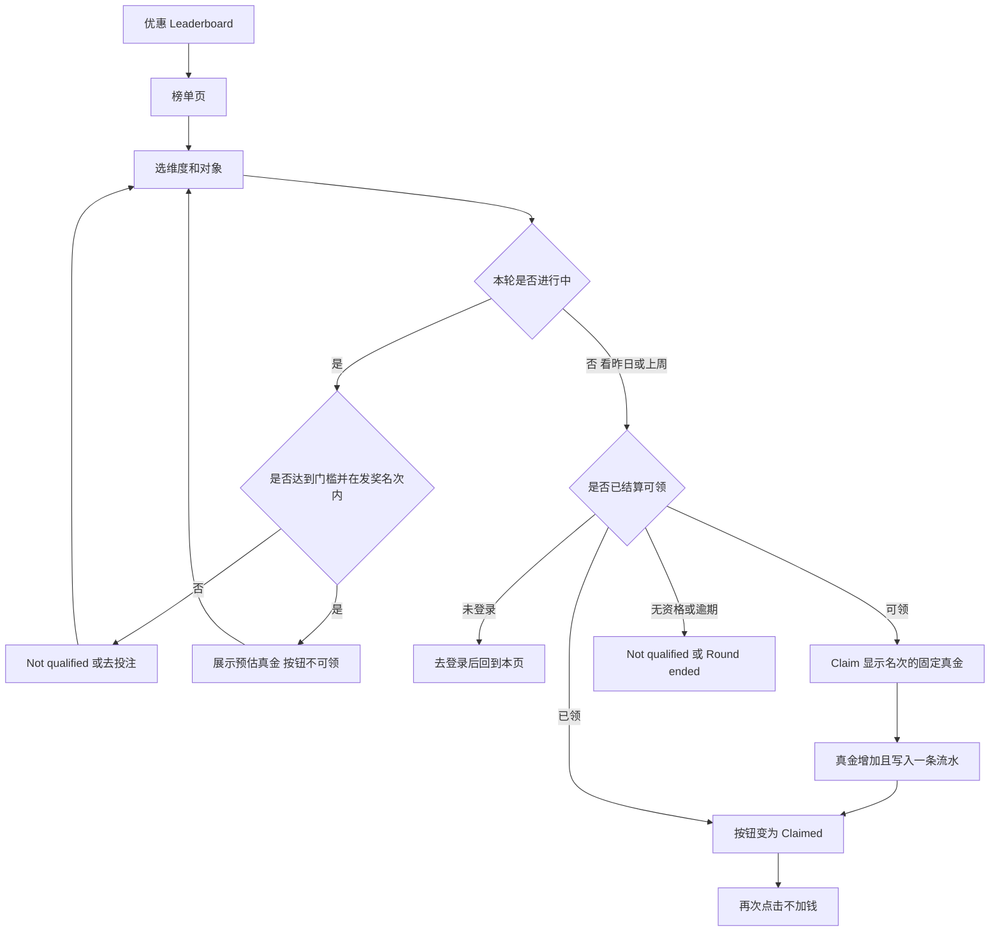

# 排行榜活动 — 前台需求说明

**文档类型：** 开发 / 测试需求  
**日期：** 2026-11-07  
**范围：** Juan365 前台，PC 与 H5 各一套榜单页  
**不含：** 原型截图、后台表单稿。后台怎么配置见 `qq-admin-prototype/docs/排行榜活动-后台需求说明.md`。

本文只写玩家在前台看到什么、怎么领。走查用的名次和金额是配置示例，不能当作正式对账口径。

---

## 一、需求背景与目标

### 1.1 背景

玩家从优惠进入排行榜，按有效投注额看自己的名次。名次对应一笔固定真金。投注额只决定名次，不按自己占全部投注的比例分奖池。

前台同时提供三种榜：游戏类型、游戏厂商、单独子游戏。一张后台活动只提供一种。多个对象拆成多张榜，奖金表相同，排名和领取各自独立。

进行中的一轮只给预估金额，不能领。轮次结算后 72 小时内，玩家在榜单页手动领取自己显示名次的真金。365 没有彩金，这笔钱进入真金钱包。

机器人占位名次在前台必须看起来像普通玩家。页面上不出现「机器人」。

### 1.2 路径 / 权限 / 联通

| 项 | 说明 |
|----|------|
| PC 入口 | 优惠列表中的 Leaderboard，进入 `#/leaderboard`。 |
| H5 入口 | 优惠里的同一条 Leaderboard，进入 H5 `#/leaderboard`。底栏仍用现有 Promos。 |
| 谁能看榜 | 未登录可以看公开榜、奖金和规则，看不到自己的名次，也不能领取。 |
| 谁能领 | 已登录，并且这一轮已经结算、自己的显示名次有大于 0 的固定真金、还没领过、仍在 72 小时内。 |
| 联通 | 榜单、门槛、周期、奖金、机器人名次、打码倍数、有效天数来自后台已开启的排行榜活动。领取成功后真金钱包增加，账户流水增加一条 Leaderboard 记录。 |
| 两端关系 | PC 和 H5 用同一个会员、同一个真金钱包、同一条领取记录。一端领过，另一端就是已领取。 |
| 去投注 | 未达门槛时，「Bet ₱门槛 to Qualify」进入该榜配置的游戏分类或游戏。 |

### 1.3 目标

1. PC 和 H5 都能按游戏类型、厂商、子游戏切换榜单，并看到前三名奖台、资格进度、置顶的自己、名次表和规则。
2. 进行中只显示预估真金，按钮不可领。
3. 结算后，玩家领到的是自己显示名次的固定真金，只入账一次。
4. 机器人占位时，真实玩家的名次和奖金都往后移到空出名次，页面不暴露机器人。

### 1.4 业务要求

| 事项 | 执行 |
|------|------|
| 排名 | 只看本榜范围内的有效投注额，高的在前。作废、取消注单不算。 |
| 并列 | 金额相同，先达到该金额的排前面。 |
| 奖金 | 显示名次落在哪一档，就领那一档的固定金额。同一档里每个名次金额相同。 |
| 发奖截止 | 后台奖金表最后一行的名次止之后，不再发奖。 |
| 门槛 | 本轮有效投注达到后台门槛才有资格。门槛为 0 时不设资格线。 |
| 刷新 | 榜单每 10 分钟刷新。结算以官方有效投注记录为准，不用页面缓存发奖。 |
| 时区 | 文案标明 GMT+8。每日是自然日，每周是周一 00:00 到周日 23:59。 |
| 领取 | 只有手动领取。结算后 72 小时内可领，逾期失效。不自动到账。 |
| 资金 | 只加真金。流水类型 Leaderboard，状态已领取，渠道 Cash。 |
| 流水 | 打码倍数为 0 时，这笔奖金不另加流水要求。大于 0 时，提现前完成「奖金 × 倍数」。有效天数从到账当天起算，过期未完成打码则这笔奖金不能提现。 |
| 机器人 | 前台无「机器人」字样。占位行使用普通掩码账号。真实玩家不能领占位名次的奖金。 |
| 多榜 | 一个账号在每张榜上只有一个名次。不同榜的真金分开领取、分开入账。 |

明确不做：

- 不把奖金写成 Bonus 入账，列名和到账都用 Cash。
- 不显示「Credited before 14:00」或任何自动到账文案。
- 不按投注占比拆奖池。
- 不把走查示例写成可对账账单。

---

## 二、详细功能说明

### 2.1 优惠入口

1. **功能名称：** Leaderboard 入口
2. **功能说明：** 从优惠列表进入榜单，不进入别的活动详情。
3. **展示规则：** 卡片标题 Leaderboard。说明文案：`Fixed cash by rank. Your bet decides the place. Claim within 72 hours after the round ends.` 标签 Leaderboard。有已开启的排行榜活动时才展示入口。全部关闭时不展示。
4. **交互逻辑：** 点击卡片进入榜单页，默认落在游戏类型下的第一张进行中的榜。从浮标进入时，落到该浮标对应活动的维度。
5. **业务规则：** 入口不发奖，只跳转。
6. **状态说明：** 有开启活动：可点。无开启活动：入口不出现。
7. **延伸：** PC 与 H5 各走自己的榜单页，规则相同。

### 2.2 榜单头图、倒计时、资格条

1. **功能名称：** 头图与资格
2. **功能说明：** 告诉玩家这张榜的周期、最高奖金、离本轮结束还有多久、自己离门槛还有多远。
3. **展示规则：**
   - 眉题：周期 · 活动开始日期 – 活动结束日期。
   - 标题：`{榜单名称}, up to ₱{第 1 名金额}`。第 1 名金额取奖金表第一档。
   - 副文案三种：进行中且未到可领，显示剩余时间，格式 `2d 2h 10m left`，不足一天则不显示天数；可领取时显示 `Claim before {领取截止时间}`；本轮已结束且不可领时显示 `Round ended`。后面都接 `· Updates every 10 minutes · GMT+8`。
   - 资格条始终显示：`Bet ₱{当前有效投注} / ₱{门槛} to qualify`。未登录时当前投注显示为 0 或 `--` 所在行的资格仍展示门槛。
4. **交互逻辑：** 倒计时随本轮结束时间变化。切到昨日或上周时，若该轮可领，副文案改成领取截止时间；已领或不可领则是 Round ended。
5. **业务规则：** 剩余时间只对进行中的轮次倒计时，不对领取截止时间倒计时。领取截止时间用完整日期时间写出。刷新周期固定 10 分钟，页面注明最近一次刷新时间。
6. **状态说明：** 进行中：倒计时。可领：Claim before。已结束不可领：Round ended。
7. **延伸：** 头图不出现机器人、彩金、自动到账。

### 2.3 维度、对象、轮次切换

1. **功能名称：** 三层切换
2. **功能说明：** 玩家先选维度，再选这张维度下的某一张榜，再看本轮或上一轮。
3. **展示规则：** 第一层固定三项：Game type、Provider、Game。第二层是该维度下每张开启榜的对象名，例如 Slot、Casino、JILI、Wild Bounty Showdown。第三层：每周榜是 This week / Last week；每日榜是 Today / Yesterday；活动期内的榜没有第三层。
4. **交互逻辑：** 点第一层，第二层回到该维度第一张榜，轮次回到本轮。点第二层，轮次回到本轮。点第三层，只换轮次，不换榜。没有上一轮数据的榜不显示第三层。
5. **业务规则：** 三层都只改变展示，不发奖。上一轮使用该轮结算时的排名和奖金，不因后台后来改表而变。
6. **状态说明：** 当前项高亮。只有一张对象时，第二层仍显示这一张。活动期内没有昨日、上周。
7. **延伸：** Slot 与 Casino 如果来自同一张游戏类型活动，奖金表相同，名次各自计算。

### 2.4 我的名次

1. **功能名称：** Your place
2. **功能说明：** 说明当前会员在这一轮的名次、投注、预计或可领真金，并给出唯一主动作。
3. **展示规则：** 标题 Your place。下面按状态只出现一种说明和一个主按钮。辅助说明固定为：结算后 72 小时内领取自己显示名次的真金，提现前完成对应打码倍数，奖金在有效天数内有效。
4. **交互逻辑：**

| 状态 | 说明 | 主按钮 |
|------|------|--------|
| 未登录 | Login to see your rank and cash prize on this board. | Login。登录成功后回到本榜本轮 |
| 进行中，已上榜 | 名次、有效投注、Estimated cash，并写明这个金额是该名次的固定金额 | Claim opens at round end，不可点 |
| 进行中，未达门槛 | Not qualified yet. | Bet ₱{门槛} to Qualify，去该榜的投注页 |
| 进行中，已达门槛但不在发奖名次内 | 展示投注，说明在发奖名次之外 | Not qualified，不可点 |
| 已结算，可领 | 名次、投注、Cash 金额、Claim before 截止时间 | Claim ₱{金额} |
| 已领取 | 名次、Cash 金额、Claimed to your cash balance. | Claimed，不可点 |
| 已结算但无资格或奖金为 0 | Not qualified on this round. | Not qualified，不可点 |

5. **业务规则：** 进行中的金额叫 Estimated cash，不能当已到账。可领金额叫 Cash。按钮金额必须等于该显示名次的固定奖金。未达门槛时不显示 Claim。
6. **状态说明：** 同一时刻只有一个主按钮。H5 上主按钮通栏。PC 上主按钮旁边有 Play，进入同一投注页。
7. **延伸：** 资格条已经展示当前投注和门槛，我的名次里不再重复一条进度。

### 2.5 奖台与奖金表

1. **功能名称：** Cash prizes
2. **功能说明：** 把前三名金额和完整档位展示出来，强调不是奖池分成。
3. **展示规则：** 标题 Cash prizes。前三名奖台从左到右是第 2 名、第 1 名、第 3 名，第 1 名最高。某一名没有配置金额时，该座不出现。奖台下说明：`Each rank pays this cash amount. Your bet does not split a pool.` 档位列表每行是名次或名次区间、获奖人数、固定金额。一名写 `1 winner`，多名写 `n winners`。
4. **交互逻辑：** 奖台和档位只展示，不可点。切换榜单时整表换成该榜的奖金。
5. **业务规则：** 获奖人数等于名次止减名次起再加 1。金额与后台该档固定奖金一致，保留两位小数，币种为 ₱。
6. **状态说明：** 没有奖金配置的开启活动不应出现。若奖表为空，本榜不展示，视为后台未通过保存。
7. **延伸：** 列名用 Cash，不用 Bonus。

### 2.6 名次表与置顶自己

1. **功能名称：** 名次表、You
2. **功能说明：** 展示本轮已上榜的名次，并把当前会员钉在表下。
3. **展示规则：** PC 表头 Rank、Player、Bet、Cash。前三名用金、银、铜名次。玩家列有头像首字母和掩码账号：超过两个字符时保留首字、三个星号、末字。投注和奖金两位小数。当前会员那一行高亮。表下 You 行：名次或 `--`、You、投注、奖金或 Not qualified。表下注明最近刷新时间，以及相同投注先达到者靠前。默认展示到发奖最后一名，原型走查至少能看到前 10 名里已有的行。H5 用名次、玩家和投注、右侧 Cash，You 行同样钉住。
4. **交互逻辑：** 名次表不能直接领取。领取只走 Your place 的按钮。切轮次后，表和 You 一起换成该轮。
5. **业务规则：**
   - 账号掩码对真实玩家和占位行一样。
   - 占位行不标机器人，不给当前会员领。
   - 真实玩家按有效投注在非占位名次里从高到低排列。
   - 占位行的展示投注额只用来让整榜从高到低看起来连续，不入账、不发奖、不进会员流水。
   - 示例：占住第 1、2、3 名，真实玩家里投注最高的人显示第 4 名，Cash 用第 4 名所在档，不用第 1 名的金额。
6. **状态说明：** 未登录时 You 的名次为 `--`，投注为 `--`，奖金为 Not qualified。已登录未上榜时名次为 `--`，奖金为 Not qualified。已上榜时名次、投注、奖金与 Your place 一致。
7. **延伸：** 官方记录与页面不一致时，以结算时的官方有效投注为准改最终名次。进行中的差异等到下一次 10 分钟刷新。

### 2.7 手动领取

1. **功能名称：** Claim
2. **功能说明：** 把已结算轮次里、自己显示名次的固定真金领进真金钱包。
3. **展示规则：** 只有 2.4 的「已结算，可领」出现 Claim 按钮，按钮文字带金额。成功后按钮变为 Claimed，说明变为已领到真金余额。顶部真金余额同步增加。
4. **交互逻辑：** 点击 Claim 时再次确认仍是可领。通过后：这笔轮次记为已领取，真金加上该金额，写入一条流水，提示 `Claimed ₱{金额}. Turnover ×{倍数} before withdrawal.` 然后刷新本页。未登录点领取先去登录。已领或不具备资格时不再加钱，已领提示 Already claimed，无资格提示 Not qualified。
5. **业务规则：**
   - 唯一键是「会员 + 榜 + 轮次」。本轮、昨日、上周是不同轮次。
   - 金额等于点击时该显示名次的固定真金。金额为 0 不加钱。
   - 流水：类型 Leaderboard，状态已领取，渠道 Cash，金额为本次领取金额，时间用领取时间。
   - PC 与 H5 共用这条唯一键和同一个真金余额。
   - 连点、刷新、换端再点，都不得第二次入账。
   - 超过领取截止时间后按钮不再出现，未领金额失效。
6. **状态说明：** 可领 → 已领。失败时保持可领。已领不可回到可领。
7. **延伸：** 提现是否放行，还要看这笔奖金的打码倍数和有效天数。有效天数从到账当天起算。

### 2.8 规则说明

1. **功能名称：** How it works
2. **功能说明：** 用文字写清统计、资格、刷新、领取和多榜。
3. **展示规则：** 五条，PC 与 H5 语义相同。
   1. 只统计本榜有效投注，作废和取消不算。
   2. 达到门槛才有资格。投注决定名次。真金是该名次的固定金额。
   3. 每 10 分钟刷新。最终名次以官方投注记录为准。
   4. 结算后 72 小时内领取显示名次的真金。提现前完成对应打码。奖金在配置的有效天数内有效。
   5. 一个账号在每张榜只有一个名次。不同榜的真金分开发放。
4. **交互逻辑：** 只读。
5. **业务规则：** 文案不得写自动到账、彩金、机器人。后台活动说明若写给玩家看，可放在规则区，但不能推翻上面五条。
6. **状态说明：** 始终展示。
7. **延伸：** 活动说明里的机器人句子只允许出现在后台。前台规则用「自己的显示名次」表达。

### 2.9 PC 与 H5 的布局

1. **功能名称：** 两端各一套页面
2. **功能说明：** 规则相同，排版按端分开。
3. **展示规则：**
   - PC：头图和资格条在上。中间两列，左为 Your place，右为 Cash prizes。下面是名次表和 You。最后是 How it works。
   - H5：单列。顺序为头图、资格条、三层切换、Your place、Cash prizes、名次列表和 You、How it works。主按钮通栏。名次行在窄屏上把投注放在玩家名下方，Cash 在右侧。
4. **交互逻辑：** 切换、领取、去投注在两端结果相同。H5 不跳进 PC 才允许领取。
5. **业务规则：** 不允许 H5 少掉奖台、资格条、You、领取截止时间或规则。不允许 PC 把 H5 收成只有名次和金额的短列表。
6. **状态说明：** 两端状态集合与 2.4 相同。
7. **延伸：** 窄屏浏览器打开 PC 地址时，仍是 PC 页面的自适应，不替代 H5 这一套。

### 2.10 走查示例

下列数字只用于对照页面，不是正式账单。会员示例账号 `wjfytn329022`。门槛都是 100。第 1、2、3 名被占位时，真实名次从第 4 名开始显示。

| 榜 | 轮次 | 显示结果 | 按钮 |
|----|------|----------|------|
| Slot 周榜 | 本周进行中 | 显示第 9 名，预估真金 350.00 | Claim opens at round end |
| Slot 周榜 | 上周已结算 | 显示第 4 名，真金 350.00。第 4–10 名同一档 | 在截止时间前可 Claim ₱350.00 |
| Casino 周榜 | 本周 | 有效投注 86.50，未达 100 | Bet ₱100.00 to Qualify |
| JILI 日榜 | 今日进行中 | 显示第 5 名，预估真金 200.00 | Claim opens at round end |
| JILI 日榜 | 昨日已结算 | 显示第 3 名，真金 1,500.00 | 在截止时间前可 Claim |
| Wild Bounty | 活动期内进行中 | 显示第 1 名，预估真金 8,000.00 | Claim opens at round end |

Slot 上周领取成功后，真金增加 350.00，流水一条，按钮变为 Claimed。再点不加钱。JILI 昨日领取的是 1,500.00，不是第 1 名的 3,000.00。

---

## 三、流程图 / 交互说明

从 H5 领取和从 PC 领取进入同一个「真金增加」节点。换端后再打开，直接进入已领状态。

---

## 四、异常场景

| 异常场景 | 触发条件 | 用户感知 | 系统处理 | 是否可重试 | 备注 |
|----------|----------|----------|----------|------------|------|
| 接口失败 / 超时 | 拉榜或领取时接口失败、超时 | 拉榜失败时保留上一份榜或显示页面失败。领取失败时余额不变 | 领取失败不记已领，不增加真金 | 可 | 玩家可再次点 Claim |
| 空数据 / 无记录 | 该维度没有任何开启的榜 | 该层没有对象，或入口不展示 | 不展示空奖台，不发奖 | 不适用 | 等后台开启后再出现 |
| 未登录 | 未登录打开榜单或点领取 | 看得到公开榜，看不到自己的名次 | 领取改为登录，登录后回到原榜 | 可 | 登录本身不发奖 |
| 无权限 | 会员被限制参与活动或账号不可用 | 不能领取 | 不增加真金，按钮保持不可领并说明原因 | 否 | 沿用账号现有限制，不另造一种榜单权限 |
| 重复提交 | 连点 Claim，或 PC 领完再在 H5 点 | 第一次成功，之后按钮是 Claimed | 第二次不加钱、不写第二笔流水 | 否 | 唯一键是会员、榜、轮次 |
| 图片 / 资源加载失败 | 头像或奖台样式资源失败 | 名次、账号、金额仍在 | 用首字母头像，不挡住领取 | 可 | 资源失败不改变金额 |
| 页面加载失败 | 榜单页打不开 | 页面失败，不显示半份名次 | 不发奖 | 可 | 重新进入 |
| 第三方降级 | 榜单每 10 分钟刷新失败 | 仍显示上一份榜，进行中不可领 | 结算改用官方投注记录重算，不用过期缓存发奖 | 可 | 刷新恢复后更新预估 |
| 未达门槛 | 有效投注低于门槛 | Not qualified，并给出去投注按钮 | 无领取按钮 | 可 | 投注达标并刷新后重新判断 |
| 逾期 | 超过结算后 72 小时仍未领 | Round ended，不能领 | 金额失效，不加真金 | 否 | 不补发 |
| 奖金为 0 | 显示名次的固定奖金配置为 0 | 不提供 Claim | 不加钱 | 否 | 视为该名次无奖金 |
| 活动已关闭 | 后台在未领时关闭活动 | 入口和榜单不再打开 | 不再从该入口领取。已入账真金保留 | 否 | 重新开启不补已逾期轮次 |

---

## 五、验收标准

### 功能

- [ ] 优惠入口进入榜单，不进入其他活动详情。
- [ ] 游戏类型、厂商、子游戏都能切换，多个对象分成多张榜。
- [ ] 每周榜有本周和上周，每日榜有今日和昨日，活动期内没有上一轮切换。
- [ ] 进行中只显示预估真金，按钮是 Claim opens at round end。
- [ ] 未达门槛显示 Not qualified，并可以去投注。
- [ ] 结算后 Claim 的金额等于显示名次的固定真金。
- [ ] 占住第 1、2、3 名时，最好的真实玩家显示第 4 名并领第 4 名的金额。
- [ ] 页面任何位置都不出现「机器人」。
- [ ] 领取后真金增加，流水为 Leaderboard、已领取、Cash。
- [ ] 同一轮次第二次领取不加钱。PC 领过的，H5 是 Claimed。
- [ ] 没有自动到账文案，没有彩金入账。

### 页面

- [ ] 标题含 up to 和第 1 名金额。
- [ ] 有资格条、前三名奖台、档位人数、Rank / Player / Bet / Cash、You、五条规则。
- [ ] 头像是首字母，账号按首字、三个星号、末字掩码。
- [ ] H5 是单列，且包含与 PC 相同的信息，不是只剩名次和金额。

### 交互

- [ ] 切换维度会回到该维度第一张榜的本轮。
- [ ] 可领时副文案是 Claim before 加截止时间。
- [ ] 未登录点 Login 或 Claim，登录后回到榜单。
- [ ] Play 和 Bet to Qualify 进入该榜配置的投注页。

### 数据

- [ ] 金额两位小数，币种 ₱。
- [ ] 第 4–10 名同一档时，第 4 名和第 9 名金额相同。
- [ ] 门槛 100 时，86.50 无资格，100 及以上才进入排名判断。
- [ ] 相同投注额时，先达到的排前面。
- [ ] 占位行的展示投注额不产生流水、不发奖。

### 异常

- [ ] 第四节的领取失败、重复领取、未登录、逾期、奖金为 0 都按表处理。

### 兼容

- [ ] PC 页面和 H5 页面分别验收，状态和金额一致。
- [ ] 一端领取后，另一端刷新即为已领取。

### 性能

- [ ] 连点 Claim 只入账一次。
- [ ] 进行中的榜在本轮结束前不能通过连点变成领取。

### 埋点

本需求不要求埋点。

---

## 六、风险预估

### 6.1 领到占位名次或第 1 名的金额

1. **是什么：** 机器人占住前列后，真实玩家仍领第 1 名的固定真金。
2. **影响：** 多发真金，并可进入提现。
3. **出问题后怎么处理：** 停止该轮继续领取。按显示名次核对已发金额，多发部分冻结提现并人工冲正。未领的改为显示名次的金额。
4. **有没有降级：** 有。领取只认结算快照里的显示名次。后台也可先清空占位名次，使后续轮次全部按真实玩家排名。

### 6.2 重复入账

1. **是什么：** 连点、超时重试、PC 和 H5 各领一次，真金加了两次。
2. **影响：** 多发真金。
3. **出问题后怎么处理：** 会员、榜、轮次只能有一条成功领取。后到的请求直接返回已领取。已多出的金额冻结并冲正，多写的流水作废。
4. **有没有降级：** 有。先落领取记录，再加真金。记录已存在则不加。

### 6.3 进行中的预估被当成已到账

1. **是什么：** 本轮还没结束，页面或接口把预估真金打进钱包。
2. **影响：** 名次还会变化，提前入账会造成错发。
3. **出问题后怎么处理：** 冲回这笔未结算金额，按钮恢复为不可领。已提现的冻结后续提现并人工处理。
4. **有没有降级：** 有。进行中接口不提供领取。只有结算完成且在 72 小时内才可领。

### 6.4 入到彩金或自动到账

1. **是什么：** 奖金进入彩金钱包，或结算后系统自动入账。
2. **影响：** 科目错误，手动领取和逾期失效都失效。
3. **出问题后怎么处理：** 自动入账的记成已领取，避免再领。错入彩金的调整到真金。关闭自动任务。
4. **有没有降级：** 有。前台只提供手动 Claim，成功结果只改真金和 Cash 流水。

### 6.5 用页面缓存发最终奖金

1. **是什么：** 刷新延迟超过 10 分钟，结算直接采用页面上的旧名次。
2. **影响：** 最终名次和官方有效投注不一致，发错人。
3. **出问题后怎么处理：** 用结算时点的官方有效投注重算名次和金额。已错发的冻结提现并按重算结果冲正。
4. **有没有降级：** 有。刷新失败时页面继续展示旧榜，但进行中不可领。最终发奖不读这份额缓存。

### 6.6 一端领完另一端还能领

1. **是什么：** PC 已领取，H5 仍显示 Claim 并再次入账。
2. **影响：** 同一轮次多发一笔真金。
3. **出问题后怎么处理：** 两端读取同一条领取记录。后一端发现已领就只显示 Claimed。多发按 6.2 冲正。
4. **有没有降级：** 有。领取记录按会员、榜、轮次全局唯一，不按端分开。
